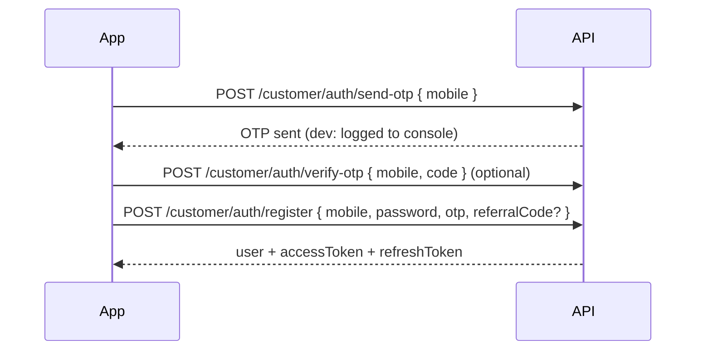
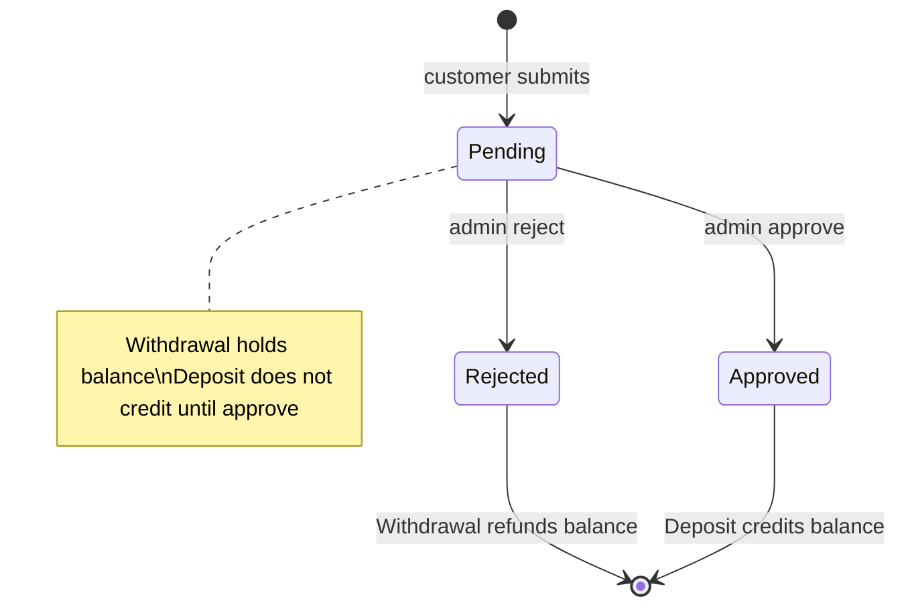

# Tecqora API — Full integration guide

Documentation for **customer app (mobile/PWA)**, **customer web**, and **admin panel** developers integrating with `investment-panel-backend`.

**Reference implementations**

| Client | API wrapper |
|--------|-------------|
| Admin panel | `investment-panel-admin/src/services/adminApi.ts` |
| HTTP client | `investment-panel-admin/src/services/api.ts` (envelope parsing) |

**Compact route tables:** [ADMIN_API.md](./ADMIN_API.md) · [CUSTOMER_API.md](./CUSTOMER_API.md)

---

## Table of contents

1. [Base URL & health](#base-url--health)
2. [Route map](#route-map)
3. [HTTP conventions](#http-conventions)
4. [Response envelope & errors](#response-envelope--errors)
5. [Authentication (JWT)](#authentication-jwt)
6. [Maintenance mode](#maintenance-mode)
7. [Public API](#public-api-no-auth)
8. [Customer auth](#customer-auth-no-bearer)
9. [Customer API](#customer-api-bearer-token)
10. [Admin API](#admin-api-bearer-token)
11. [File uploads](#file-upload-cloudinary)
12. [Domain enums & business rules](#domain-enums--business-rules)
13. [Background jobs & income](#background-jobs--income)
14. [Environment variables](#environment-variables)
15. [Local setup](#local-setup-for-new-developers)
16. [Client checklists](#client-implementation-checklists)
17. [Not implemented / roadmap](#not-implemented--roadmap)

---

## Base URL & health

| Environment | Base URL |
|-------------|----------|
| Local | `http://localhost:8001/api/v1` |
| Production | `https://<your-api-host>/api/v1` |

| Method | Path | Auth | Description |
|--------|------|------|-------------|
| GET | `/` | No | Root info (`version`, `environment`, pointer to health) |
| GET | `/health` | No | Liveness + DB probe |

**Health `data`:**

```json
{
  "status": "healthy",
  "version": "1.0.0",
  "environment": "development",
  "database": "connected",
  "timestamp": "2026-04-01T12:00:00.000Z"
}
```

`database` is `connected` | `disconnected` | `not_configured`.

**CORS:** Set `FRONTEND_URL` in backend `.env`. Production allows that origin plus built-in dev origins (`localhost:3000`, `localhost:5173`). In non-production, any `localhost` / `127.0.0.1` port is allowed. Methods: `GET`, `POST`, `PUT`, `PATCH`, `DELETE`, `OPTIONS`, `HEAD`. Header: `Authorization` allowed.

**Rate limit:** 500 requests per 5 minutes per IP (global). Response when exceeded: plain text message from rate limiter (not the JSON envelope).

---

## Route map

All API routes mount under **`/api/v1`**.

```
/api/v1
├── GET  /health
├── POST /auth/login                          → Admin login
├── POST /uploads                             → Admin upload (Bearer admin)
├── /public/*                                 → No auth (maintenance-aware)
├── /customer/auth/*                          → Customer OTP / register / login / refresh (maintenance-aware)
├── /customer/*                               → Customer app (Bearer user + maintenance-aware)
└── /admin/*                                  → Admin panel (Bearer admin; NOT maintenance-blocked)
```

**Token kinds:** Admin JWT payload includes `kind: "admin"`. Customer JWT includes `kind: "user"`. Cross-use returns **401** (`Admin token required` / `Customer token required`).

---

## HTTP conventions

| Header | Value |
|--------|--------|
| `Content-Type` | `application/json` for bodies (except multipart upload) |
| `Authorization` | `Bearer <accessToken>` on protected routes |
| `Accept` | `application/json` (recommended) |

**Pagination (admin lists):** query `page` (default `1`), `limit` (default `20`, max `100`). Response includes `meta`: `{ page, limit, total, totalPages }`.

**Amounts:** JSON **numbers** in BDT (2 decimal places in DB; serialized as JS numbers).

**Dates in JSON:** mostly `YYYY-MM-DD` or `YYYY-MM-DD HH:mm` (server local formatting). Some fields use ISO strings (e.g. pending dashboard `time`, refresh `refreshExpiresAt`).

**Field aliases (customer):** accepted in several endpoints to ease mobile clients:

| Canonical | Aliases |
|-----------|---------|
| `otp` | `code` |
| `referralCode` | `sponsor` |
| `method` (deposit) | `methodName` |
| `currentPassword` | `current` |
| `newPassword` | `newPass` |
| `productId` (purchase) | URL param `:id` on `POST /customer/products/:id/purchase` |

**Status strings (API ↔ UI):** backend maps DB enums to display strings on reads; writes accept display strings or lowercase.

| Domain | API values |
|--------|------------|
| Record / product / banner / video / VIP / payment active flag | `Active`, `Inactive` (or `active` / `inactive`) |
| User | `Active`, `Blocked`, `Inactive` |
| Deposit / withdrawal | `Pending`, `Approved`, `Rejected` |
| FAQ / rules / posts | `Published`, `Draft` |
| Deposit/withdrawal review body | `"action": "approve"` \| `"reject"` |

---

## Response envelope & errors

### Success (2xx)

```json
{
  "success": true,
  "message": "Human-readable message",
  "data": {},
  "meta": { "page": 1, "limit": 20, "total": 100, "totalPages": 5 },
  "error": null,
  "path": "/api/v1/admin/users?page=1"
}
```

- **`meta`:** only on paginated admin lists.
- **`path`:** present on success responses from `sendResponse`.

### Error (4xx / 5xx)

```json
{
  "success": false,
  "message": "Valid mobile is required",
  "data": null,
  "error": null
}
```

- **`error`:** optional detail — Zod issues `[{ path, message }]`, Prisma duplicate `{ fields }`, etc.
- Error responses **do not** include `path` today.

### HTTP status codes

| Code | Typical cause |
|------|----------------|
| 200 / 201 | OK / created |
| 400 | Validation, bad input, business rule (e.g. insufficient balance) |
| 401 | Missing/invalid/expired JWT, wrong password |
| 403 | Blocked customer account |
| 404 | Resource not found |
| 409 | Conflict (duplicate mobile, deposit already reviewed, category has products) |
| 503 | Maintenance mode; Cloudinary not configured |

---

## Authentication (JWT)

### Admin panel

**1. Login** — `POST /auth/login` (no Bearer)

```json
{ "adminId": "admin", "password": "123456" }
```

Use `"email"` instead of `"adminId"` if you prefer (same field: admin login id).

**Response `data`:**

```json
{
  "user": {
    "id": "cuid",
    "email": "admin",
    "fullName": "Tecqora Admin",
    "role": { "slug": "super_admin" }
  },
  "accessToken": "<JWT>"
}
```

**2. Protected admin routes:** `Authorization: Bearer <accessToken>` on all `/admin/*` and `POST /uploads`.

**3. Session model:** stateless JWT only — **no admin refresh token**. On **401**, clear token and redirect to login.

| Method | Path | Body | Response `data` |
|--------|------|------|-----------------|
| GET | `/admin/me` | — | `{ id, adminId, fullName, role }` |
| PATCH | `/admin/me/password` | `{ currentPassword, newPassword }` | `null` |

Password rules: minimum **6** characters.

**Seed admin (after `npm run prisma:seed`):** `admin` / `123456`

**JWT config:** `JWT_SECRET`, `JWT_EXPIRES_IN` (default `7d`).

---

### Customer app / web

#### Registration flow



| Step | Method | Path | Body |
|------|--------|------|------|
| 1 | POST | `/customer/auth/send-otp` | `{ "mobile": "01712345678" }` |
| 2 | POST | `/customer/auth/verify-otp` | `{ "mobile", "code" }` — optional; register can verify inline |
| 3 | POST | `/customer/auth/register` | `{ "mobile", "password", "otp", "referralCode?" }` |

**Mobile normalization:** non-digits stripped; last **11** digits kept (Bangladesh-style).

**Register validation:** password ≥ 6 chars; mobile unique (**409** if taken); valid OTP (or dev bypass).

**Register response `data` (201):**

```json
{
  "user": { "...see user object..." },
  "accessToken": "<JWT>",
  "refreshToken": "<opaque>",
  "expiresIn": "7d",
  "refreshExpiresAt": "2026-05-01T12:00:00.000Z"
}
```

#### Login & refresh

| Method | Path | Body |
|--------|--------|------|
| POST | `/customer/auth/login` | `{ "mobile", "password" }` |
| POST | `/customer/auth/refresh` | `{ "refreshToken" }` |
| POST | `/customer/auth/sign-out` | optional `{ "refreshToken" }` — requires Bearer + maintenance off |

**Login:** **403** if user status is `Blocked`. **401** invalid credentials.

**Refresh:** **rotation** — old refresh token deleted; new pair issued. **401** if invalid/expired/revoked.

**Protected customer routes:** `Authorization: Bearer <accessToken>` on `/customer/*` except auth routes under `/customer/auth/*`.

**Dev OTP:** set `OTP_DEV_CODE=123456` in `.env` to accept that code without SMS. In development, OTP is also printed to the server console. **Production SMS is not wired yet.**

**Seed customer:** `01712345678` / `123456` (referral code `REF245` in seed).

**Refresh token storage:** hashed in DB; default lifetime `JWT_REFRESH_EXPIRES_DAYS` (default **30**).

#### Customer user object

Returned on login, register, refresh, `GET /customer/me`:

```json
{
  "id": "cuid",
  "mobile": "01712345678",
  "referralCode": "REF245",
  "sponsorId": "",
  "balance": 12500,
  "totalDeposit": 85000,
  "totalWithdraw": 42000,
  "totalEarnings": 18400,
  "directReferrals": 1,
  "teamCount": 2,
  "vipLevel": "VIP 2",
  "registeredAt": "2026-01-15",
  "status": "Active"
}
```

---

## Maintenance mode

Stored in `PlatformSetting` key **`maintenance`**: `{ "enabled": true, "message": "..." }`.

When enabled:

- **`/public/*`** → **503** with `message`
- **`/customer/auth/*`** → **503** (registration/login blocked)
- **`/customer/*`** → **503**
- **`/admin/*`**, **`POST /auth/login`**, **`POST /uploads`**, **`GET /health`** → still work so operators can disable maintenance

---

## Public API (no auth)

Prefix: **`/public`**. All routes blocked during maintenance.

| Method | Path | Response `data` summary |
|--------|------|-------------------------|
| GET | `/public/home` | `{ homepage, general, telegram, appDownload }` — JSON blobs from settings |
| GET | `/public/banners` | Active banners: `id, title, subtitle, imageUrl, link, order` |
| GET | `/public/faqs` | Published: `id, question, answer, order` |
| GET | `/public/rules` | Published: `id, title, content, order` |
| GET | `/public/videos` | Active: `id, title, url, thumbnailUrl, description, order` |
| GET | `/public/posts` | Published: `id, title, content, imageUrls[], publishedAt` |
| GET | `/public/lucky-gifts` | Active campaigns: `id, name, details, bannerUrl, endAt, productId, status` |
| GET | `/public/announcement-popup` | One active popup or **`null`** |
| GET | `/public/app-download` | Setting `app_download` JSON |
| GET | `/public/telegram` | Setting `telegram` JSON |
| GET | `/public/categories` | Active categories + `productCount` |
| GET | `/public/products` | Active products (list fields) |
| GET | `/public/products/:id` | Full product detail (**404** if inactive/missing) |

**Product list item:** `id, category, name, description, imageUrl, price, dailyIncome, contractDays, totalReturn, points, minVip`

**Product detail adds:** `teamCommission, minPurchase, maxPurchase, allowRepurchase, availableFrom, availableTo`

**Client pattern:** browse catalog via `/public/*`; wallet, purchase, deposits via `/customer/*` after login.

---

## Customer auth (no Bearer)

Prefix: **`/customer/auth`**. Maintenance-aware (503 when on).

| Method | Path | Notes |
|--------|------|-------|
| POST | `/customer/auth/send-otp` | `data`: `{ mobile, expiresInMinutes: 10 }` |
| POST | `/customer/auth/verify-otp` | `data`: `{ mobile, verified: true }` |
| POST | `/customer/auth/register` | 201 — see above |
| POST | `/customer/auth/login` | 200 — tokens + user |
| POST | `/customer/auth/refresh` | 200 — new access + refresh (rotation) |

---

## Customer API (Bearer token)

Prefix: **`/customer`**. Requires Bearer + maintenance off.

### Profile & dashboard

| Method | Path | Body | Response `data` |
|--------|------|------|-----------------|
| GET | `/customer/me` | — | User object |
| PATCH | `/customer/me/password` | `{ currentPassword, newPassword }` | `null` |
| GET | `/customer/dashboard` | — | See below |
| POST | `/customer/auth/sign-out` | `{ refreshToken? }` | `null` |

**Dashboard `data`:**

```json
{
  "balance": 12500,
  "totalDeposit": 85000,
  "totalWithdraw": 42000,
  "totalEarnings": 18400,
  "vipLevel": "VIP 2",
  "directReferrals": 1,
  "teamCount": 2,
  "referralCode": "REF245",
  "invitationLink": "https://app.example.com/register/REF245",
  "activeProducts": 2,
  "pendingDeposits": 1,
  "pendingWithdrawals": 0,
  "pointsBalance": 150
}
```

`invitationLink` = `referral.linkBase` (setting) + `referralCode`.

### Products

| Method | Path | Body | Notes |
|--------|------|------|-------|
| GET | `/customer/products/mine` | — | All `UserProduct` rows for user |
| POST | `/customer/products/:id/purchase` | — | Deduct balance, create contract |
| POST | `/customer/products/purchase` | `{ "productId": "..." }` | Same handler |

**Purchase rules:**

- Product must exist and be **Active**
- Balance ≥ price (**400** insufficient balance)
- Active contracts ≤ `product_settings.globalMaxActiveProducts` (default **10**)
- If `allowMultipleSameProduct` is false (default true in settings when unset): only one **ACTIVE** row per product per user
- On success: balance decremented; `UserProduct` **ACTIVE** with `expiresAt = now + contractDays`
- If `product_settings.pointOnPurchase` ≠ false and product `points` > 0: points credited (`PRODUCT_POINTS` ledger)

**My product row:** `id, productId, name, category, imageUrl, pricePaid, dailyIncome, contractDays, purchasedAt, expiresAt, status` — `status` is enum `ACTIVE` | `COMPLETED` | `CANCELLED`

### Deposits & transactions

| Method | Path | Body |
|--------|------|------|
| GET | `/customer/payment-methods` | — |
| POST | `/customer/deposits` | `{ amount, method, txnId, proofUrl? }` |
| GET | `/customer/deposits` | — (last **100**) |
| GET | `/customer/transactions` | — (up to 50 deposits + 50 withdrawals, merged sort) |

**Deposit create:** amount > 0; method and txnId required. Status **Pending** until admin review.

**Payment method row:** `id, name, accountInfo, instructions` (admin `active: true` only).

**Upload proof:** `POST /customer/uploads` → use `data.url` as `proofUrl`.

### Withdrawals

| Method | Path | Body |
|--------|------|------|
| GET | `/customer/withdrawal-methods` | — |
| POST | `/customer/withdrawal-methods` | `{ method, accountNo, accountName, isDefault? }` |
| DELETE | `/customer/withdrawal-methods/:id` | — |
| POST | `/customer/withdrawals` | `{ methodId, amount }` |
| GET | `/customer/withdrawals` | — (last **100**) |

**Withdrawal limits** from setting **`withdrawal`:** defaults `min: 500`, `max: 50000`, `fee: 0` (fee returned in create response; not deducted from balance in API).

**Create withdrawal:** balance decremented immediately (hold). Admin **reject** refunds balance; **approve** increments `totalWithdraw` only.

### Team, income, points

| Method | Path | Description |
|--------|------|-------------|
| GET | `/customer/team` | Staged team overview (same shape as admin team view for self) |
| GET | `/customer/income` | Last **100** ledger rows |
| GET | `/customer/points` | Balance + conversion rules |
| POST | `/customer/points/redeem` | `{ "points": 500 }` |

**Income row:** `id, source, amount, description, date`

**Points `data`:** `{ pointsBalance, conversionRate, minRedeem }` — redeem credits `points / conversionRate` BDT to balance via ledger.

**Team summary highlights:**

- Direct downline only (sponsor = current user)
- Stages **A / B / C** by join order: index 0→A, 1→B, 2→C, 3→A, …
- Commission rates from `team_stages` setting `{ A, B, C }` percent
- Includes recharge aggregates, valid/invalid member lists (valid = `totalDeposit >= 1000`), last 20 days team commission chart

### Customer upload

| Method | Path |
|--------|------|
| POST | `/customer/uploads` |

Same as admin upload (multipart **`file`**, optional `?folder=tecqora/deposits`). Requires customer Bearer.

---

## Admin API (Bearer token)

Prefix: **`/admin`**. All routes require admin JWT.

### Dashboard

| Method | Path | Response `data` |
|--------|------|-----------------|
| GET | `/admin/dashboard` | `DashboardStats` — see below |
| GET | `/admin/dashboard/pending-deposits` | Last 5 pending: `{ id, user, amount, status, time }` |
| GET | `/admin/dashboard/pending-withdrawals` | Same shape |

**DashboardStats:**

```json
{
  "totalUsers": 0,
  "todayUsers": 0,
  "activeProducts": 0,
  "totalProducts": 0,
  "pendingDeposits": 0,
  "pendingWithdrawals": 0,
  "totalDeposit": 0,
  "totalWithdraw": 0,
  "totalEarnings": 0,
  "todayDeposit": 0,
  "todayWithdraw": 0,
  "activeVipLevels": 0
}
```

### Users

| Method | Path | Query / body |
|--------|------|----------------|
| GET | `/admin/users` | `page`, `limit`, `search`, `status` = `all` \| `active` \| `blocked` |
| GET | `/admin/users/:id` | Detail + snippets |
| PATCH | `/admin/users/:id/status` | `{ "status": "Active" \| "Blocked" \| "Inactive" }` |

**User list row:** `id, mobile, registeredAt, balance, totalDeposit, totalWithdraw, totalEarnings, vipLevel, referralCode, sponsorId, directReferrals, teamCount, status`

**User detail adds:**

- `transactions[]` — deposits + withdrawals (raw status enums in this nested list)
- `products[]` — `{ name, purchasedAt, status }`
- `income[]` — `{ source, amount, date, description }`
- `team[]` — direct referrals `{ id, mobile, level }`

### Categories

| Method | Path | Body (POST / PATCH) |
|--------|------|---------------------|
| GET | `/admin/categories` | — |
| POST | `/admin/categories` | `{ name, description?, imageUrl?, displayOrder?, status? }` |
| PATCH | `/admin/categories/:id` | partial |
| DELETE | `/admin/categories/:id` | **409** if products exist |

**Category row:** `id, name, description, imageUrl, status, displayOrder, productCount`

### Products

| Method | Path |
|--------|------|
| GET/POST | `/admin/products` |
| PATCH/DELETE | `/admin/products/:id` |

**Create POST body:**

| Field | Type | Notes |
|-------|------|-------|
| `category` | string | **Category name** (must exist) |
| `name` | string | |
| `description` | string | optional |
| `imageUrl` | string | optional |
| `price` | number | |
| `dailyIncome` | number | |
| `contractDays` | number | |
| `totalReturn` | number | optional; default `dailyIncome * contractDays` |
| `points` | number | default 0 |
| `teamCommission` | number | default 0 |
| `minVip` | string | |
| `minPurchase` / `maxPurchase` | number | default 1 |
| `allowRepurchase` | boolean | |
| `repurchaseAfterContract` | boolean | |
| `availableFrom` / `availableTo` | date string | optional |
| `status` | string | default Active |

**Product row (admin):** same fields as public detail + `status`, category name as `category`.

### Deposits & withdrawals

| Method | Path | Body / query |
|--------|------|--------------|
| GET | `/admin/deposits` | `status` = all/pending/approved/rejected, `search`, `page`, `limit` |
| POST | `/admin/deposits/:id/review` | `{ "action": "approve" \| "reject", "adminNote"? }` |
| GET | `/admin/withdrawals` | `status`, `page`, `limit` |
| POST | `/admin/withdrawals/:id/review` | `{ "action": "approve" \| "reject", "adminRef"? }` |

**Deposit row:** `id, userId, mobile, amount, method, txnId, proofUrl?, adminNote?, submittedAt, status`

**Withdrawal row:** `id, userId, mobile, amount, method, accountNo, accountName, adminRef?, requestedAt, status`

**Approve deposit:** credits user `balance` + `totalDeposit`; runs **L1–L3 referral bonus** on upline (see [Background jobs & income](#background-jobs--income)). **409** if not pending.

**Approve withdrawal:** increments user `totalWithdraw` (balance already held). **Reject:** refunds `amount` to balance.

### VIP levels

| Method | Path | Body |
|--------|------|------|
| CRUD | `/admin/vip-levels`, `/admin/vip-levels/:id` | `{ name, requiredTeam, imageUrl?, status?, teamBonusPercent? }` |

**Row:** `id, name, requiredTeam, imageUrl, status, teamBonusPercent?`

### Payment methods (deposits)

| Method | Path | Body |
|--------|------|------|
| CRUD | `/admin/payment-methods`, `/admin/payment-methods/:id` | `{ name, accountInfo, instructions?, active? }` |

Customer sees only `active: true`.

### Platform settings

| Method | Path | Body |
|--------|------|------|
| GET | `/admin/settings` | — → `{ "general": {...}, "income": {...}, ... }` |
| GET | `/admin/settings/:key` | → `{ key, value }` or `value: null` |
| PUT | `/admin/settings/:key` | `{ "value": { ... } }` **or** raw JSON object as entire body |

#### Setting keys (JSON `value`)

| Key | Purpose |
|-----|---------|
| `general` | `{ appName, currency, supportPhone }` |
| `income` | Daily income toggles/percent, team income depth, referral flags, salary multipliers |
| `team_stages` | `{ A, B, C }` — stage commission **percent** |
| `referral` | `{ level1, level2, level3, linkBase }` — deposit bonus % per level |
| `salary` | `{ weekly, monthly, annual }` each `{ minTeam, amount }` |
| `withdrawal` | `{ min, max, fee }` |
| `points` | `{ conversionRate, minRedeem }` |
| `product_settings` | `{ globalMaxActiveProducts, allowMultipleSameProduct, pointOnPurchase }` |
| `maintenance` | `{ enabled, message }` |
| `homepage` | CMS homepage sections (admin UI) |
| `telegram` | Channel / group links |
| `app_download` | Android / iOS URLs |
| `lucky_gift` | Campaign config |

**Seed examples** (`prisma/seed.ts`): `general`, `income`, `team_stages`, `points` — use as starting templates.

Admin UI modules in `investment-panel-admin` map 1:1 to these keys.

### Team management

| Method | Path | Query |
|--------|------|-------|
| GET | `/admin/team/overview` | **`leaderId`** (user id) — required |

Returns `buildTeamOverview(leaderId)` — same structure as customer `/customer/team` when `leaderId` is the logged-in user.

### Background jobs (manual)

| Method | Path | Body (optional) |
|--------|------|-----------------|
| POST | `/admin/jobs/daily-income` | `{ "date": "2026-04-01", "force": true }` |
| POST | `/admin/jobs/weekly-salary` | same |
| POST | `/admin/jobs/monthly-salary` | same |
| POST | `/admin/jobs/annual-salary` | same |

**Response `data`:** job-specific counters (e.g. daily: `{ dateKey, productPayouts, teamCommissions, skipped }`).

**Scheduler (server UTC midnight)** when `RUN_DAILY_INCOME_JOB !== "false"`:

| Schedule | Job |
|----------|-----|
| Daily | Product daily income + team commission |
| Sunday | Weekly salary (`salary.weekly`) |
| Day 1 of month | Monthly salary |
| Jan 1 | Annual salary |

Idempotency: jobs record runs in `JobRun`; same `dateKey` skipped unless `force: true`.

### CMS

Pattern: **GET** list · **POST** create · **PATCH** `/:id` update · **DELETE** `/:id`

| Resource | Base path |
|----------|-----------|
| Banners | `/admin/cms/banners` |
| FAQs | `/admin/cms/faqs` |
| Videos | `/admin/cms/videos` |
| Rules | `/admin/cms/rules` |
| Posts | `/admin/cms/posts` |
| Lucky gifts | `/admin/cms/lucky-gifts` |
| Announcement popups | `/admin/cms/announcement-popups` |
| Notifications | GET `/admin/cms/notifications`, POST `/admin/cms/notifications` |

**Banner POST/PATCH:** `{ title, subtitle?, imageUrl?, link?, order?, status? }`

**FAQ:** `{ question, answer, order?, status?: Published|Draft }`

**Video:** `{ title, url, thumbnailUrl?, description?, order?, status? }`

**Rule:** `{ title, content, order?, status? }`

**Post:** `{ title, content, imageUrls?: string[], publishedAt?, status? }`

**Lucky gift:** `{ name, details?, bannerUrl?, endAt?, productId?, status? }`

**Announcement popup:** `{ title, description?, imageUrl?, link?, startAt?, endAt?, status? }`

**Notification POST:** `{ title, message, type?, audience?, imageUrl?, link? }` — stored as campaign history; **no push delivery yet**

---

## File upload (Cloudinary)

| Audience | Method | Path | Auth |
|----------|--------|------|------|
| Admin | POST | `/api/v1/uploads` | Admin Bearer |
| Customer | POST | `/api/v1/customer/uploads` | Customer Bearer |

- Multipart field name: **`file`**
- Max size: **15 MB**
- Allowed MIME: JPEG, PNG, WebP, GIF, SVG, PDF
- Query: `?folder=tecqora/products` (sanitized; default `CLOUDINARY_FOLDER`)

**Response `data` (201):**

```json
{
  "url": "https://res.cloudinary.com/...",
  "publicId": "...",
  "resourceType": "image",
  "format": "jpg",
  "bytes": 12345,
  "originalName": "proof.jpg"
}
```

Requires `CLOUDINARY_CLOUD_NAME`, `CLOUDINARY_API_KEY`, `CLOUDINARY_API_SECRET`; else **503**.

---

## Domain enums & business rules

### Income ledger `source` values

| Value | Meaning |
|-------|---------|
| `DAILY_PRODUCT_INCOME` | Daily contract payout |
| `TEAM_COMMISSION` | Upline stage commission (meta may include `stage`) |
| `REFERRAL_BONUS` | L1–L3 on approved deposit |
| `WEEKLY_SALARY` / `MONTHLY_SALARY` / `ANNUAL_SALARY` | Salary jobs |
| `POINT_REDEEM` | Points → balance |
| `PRODUCT_POINTS` | Points on product purchase |
| `ADMIN_ADJUSTMENT` | Reserved for manual adjustments |

Credits increase **`balance`** and **`totalEarnings`** (except points-only ledger rows).

### Referral on deposit approve

Walks sponsor chain up to **3** levels. Rates from `referral.level1–3` (%), L1 fallback `income.referralCommission`. Skipped entirely if `income.referralIncomeEnabled === false`.

### Withdrawal / deposit state machine



---

## Background jobs & income

**Daily income job:**

- Pays `dailyIncome * (income.dailyIncomePercent / 100)` per active `UserProduct` not expired
- Optional team commission to uplines using product `teamCommission` and stage rates
- Controlled by `income.dailyIncomeEnabled`, `teamIncomeEnabled`

**Salary jobs:** read `salary.weekly|monthly|annual` thresholds and amounts; monthly may fallback from `income.weeklySalaryBase` × multiplier (see service code).

---

## Environment variables

| Variable | Required | Description |
|----------|----------|-------------|
| `DATABASE_URL` | Yes | Postgres (PgBouncer URL for Supabase) |
| `DIRECT_URL` | Yes | Direct Postgres for migrations |
| `JWT_SECRET` | Yes | Signing secret |
| `JWT_EXPIRES_IN` | No | Access token TTL (default `7d`) |
| `JWT_REFRESH_EXPIRES_DAYS` | No | Refresh token days (default `30`) |
| `PORT` | No | Default `8001` |
| `FRONTEND_URL` | Recommended | CORS allowlist |
| `CLOUDINARY_*` | For uploads | Cloud name, key, secret, optional `CLOUDINARY_FOLDER` |
| `OTP_DEV_CODE` | Dev only | Fixed OTP bypass |
| `RUN_DAILY_INCOME_JOB` | No | Set `false` to disable scheduler |
| `NODE_ENV` | No | `development` \| `production` |

See `.env.example` in repo root.

---

## Local setup (for new developers)

```bash
cd investment-panel-backend
npm install
cp .env.example .env   # DATABASE_URL, DIRECT_URL, JWT_SECRET, optional Cloudinary
npm run prisma:migrate -- --name init
npm run prisma:seed
npm run dev            # http://localhost:8001
```

**Prisma on Windows:** stop `npm run dev` before `npm run prisma:generate` if you see `EPERM` on the query engine.

**Verify:** `GET http://localhost:8001/api/v1/health` → `database: connected`.

---

## Client implementation checklists

### Admin panel (web)

1. Login → store `accessToken` (memory or secure storage).
2. Attach Bearer on every `/admin/*` and `/uploads` call.
3. Paginate with `meta.page`, `meta.total`, `meta.totalPages`.
4. Settings: GET all or per-key; PUT `{ value }` per module (merge client-side before save if needed).
5. Deposit/withdrawal queues: refresh after `review`; show `proofUrl` for deposits.
6. Mirror types in `adminApi.ts`.

### Customer app / PWA

1. Load `/public/home` + products without login.
2. Register with OTP; persist `accessToken` + `refreshToken`.
3. On **401**: `POST /customer/auth/refresh`; on failure → login.
4. Purchase: check balance client-side; handle **400** rules from server.
5. Deposit: upload proof → submit with `txnId`.
6. Withdrawal: save `methodId` once → request amount within min/max.
7. Deep link: `?ref=<referralCode>` → pass as `referralCode` on register.
8. Handle **503** maintenance with message from API.

### Shared

- Treat `success === false`; show `message` to users.
- Amounts always **numbers** (BDT).
- API is **Bearer-only** (cookies not used for auth).

---

## Not implemented / roadmap

| Feature | Status |
|---------|--------|
| OTP SMS gateway | DB + dev bypass only |
| Push notifications / device tokens | Not in API |
| Admin JWT refresh | Not implemented |
| Notification POST | History only; no FCM/APNs |

---

## Requirements cross-reference

Business rules and UI flows: `project_functional_requirements.md` (team APIs §70, platform §75).

**Document version:** matches backend `APP_VERSION` / package `1.0.0`. When routes change, update this file and the compact ADMIN/CUSTOMER API docs together.
